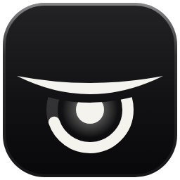
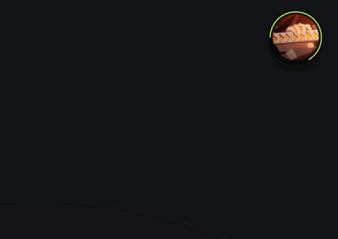
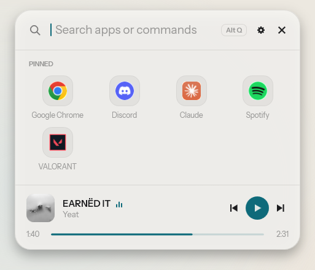
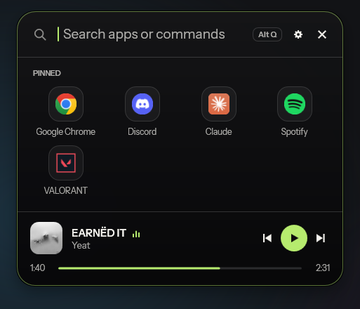
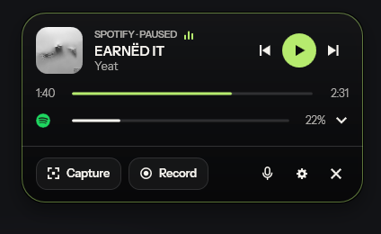
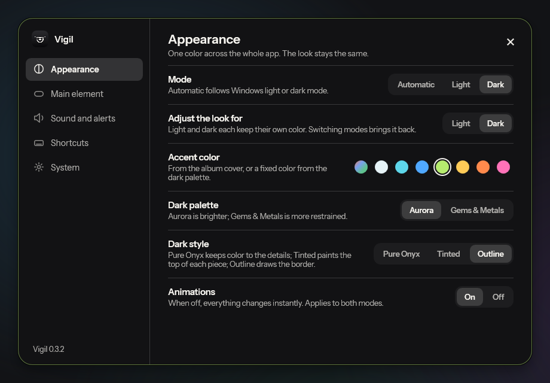

  <a href="README.md">Português</a> · <b>English</b> · <a href="README.es.md">Español</a> · <a href="README.it.md">Italiano</a> · <a href="README.uk.md">Українська</a>

  

<h1 align="center">Vigil</h1>

  <b>Your apps, your music and your PC controls on top of any game, without minimizing anything.</b>

  <a href="https://github.com/daniielquintanilha-web/vigil/releases/latest/download/Vigil-Setup.exe"><b>⬇ Download for Windows</b></a>
  &nbsp;·&nbsp; Windows 10 and 11

  

## What it is

Vigil is a small app that sits in the corner of your screen. Press a shortcut and it shows up over whatever is open, even a fullscreen game, **without stealing its focus**. The game doesn't minimize and you don't need Alt+Tab.

## The Sentinel: your GIF in the corner

  

- **Put any GIF you like:** a character, your pet, a meme. It sits in the corner, in a circle or in a capsule with the song that's playing.
- **Hover it** and the circle opens into a capsule with the song name.
- **Click it or press Alt+W** and it turns into the panel itself: music, volume, microphone, capture.
- **The outline is the song's progress:** the border fills up as the song plays.
- Prefer the top of the screen? Swap the Sentinel for the **Island**.

## What it does

- **Alt+Q, the launcher:** find and open any app, pin your favorites and use quick commands (`yt`, `g`, `w`… to search YouTube, Google, Wikipedia).
- **Alt+W, the panel:** track time, PC and per-app volume, microphone, screenshot and screen recording.
- **Alt+M, the microphone:** mute and unmute, with an on-screen notice (even in games).
- **Notices on top of the game:** when the volume or the microphone changes, a quick notice shows up where Windows shows nothing.
- **Works with** Spotify, YouTube Music, your browser and any player that appears in Windows media controls.
- **Steps aside for videos:** during a fullscreen movie or show, it hides by itself.
- **Your way:** light or dark mode, accent color (fixed or taken from the album cover), three sizes, the Island at the top of the screen as an alternative, and shortcuts you can change.
- **5 languages:** português, English, español, italiano, українська.
- **Updates itself.**

## Screenshots

| Light | Dark (green) |
|:---:|:---:|
|  |  |

| Panel (Alt+W) | Settings |
|:---:|:---:|
|  |  |

## Install

1. Download **[Vigil-Setup.exe](https://github.com/daniielquintanilha-web/vigil/releases/latest/download/Vigil-Setup.exe)**.
2. Open it. It installs in seconds, without asking for administrator rights, and opens by itself.
3. Press **Alt+Q**.

### Seeing "Windows protected your PC"?

Windows shows this warning for new programs that don't have a paid digital signature (a certificate) yet. **It doesn't mean there's a virus**: it means Windows doesn't know the program yet. To continue, click **More info** and then **Run anyway**.

## Is it safe?

- **It collects nothing.** No account, no login, no ads, no tracking.
- **It only goes online to check for updates**, here in this repository. Searches (YouTube, Google…) only open your browser when you ask.
- **The keyboard is only read while the launcher is open**, so you can type your search. Close it and that's it.
- **The microphone is never recorded or listened to.** The button only turns the Windows microphone on and off.
- **It doesn't touch your games.** It's just a window on top; it doesn't change any game's files or memory.
- **No administrator rights needed**, and it installs only in your user folder.
- **Uninstall:** Windows Settings › Apps › Vigil › Uninstall.
- **Always download it from here** (github.com/daniielquintanilha-web/vigil).

## Requirements

Windows 10 (version 2004 or later) or Windows 11, 64-bit.

## Rights

© 2026 Daniel Quintanilha. All rights reserved.

You are free to download and use Vigil. Copying, modifying, decompiling, reselling or redistributing the app (or any part of it) without the author's permission is not allowed.
