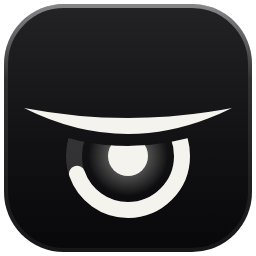
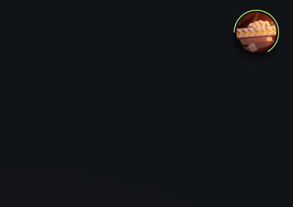
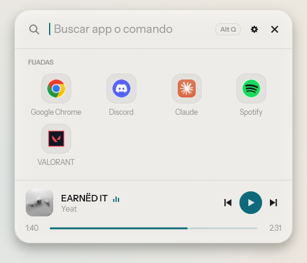
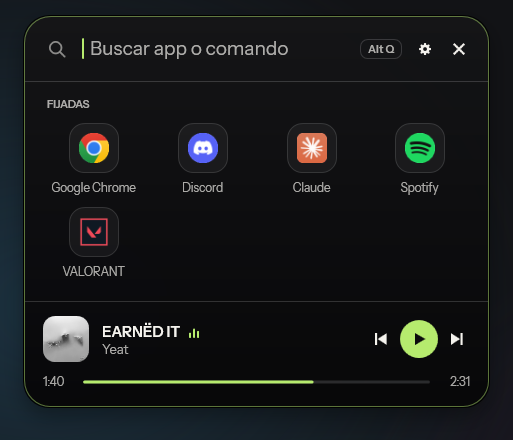
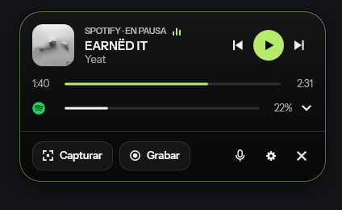
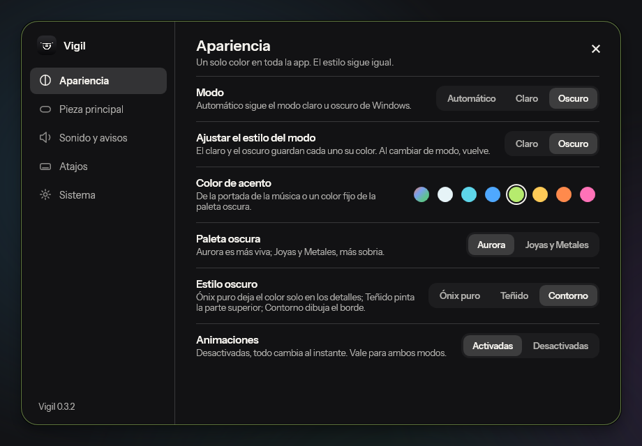

  <a href="README.md">Português</a> · <a href="README.en.md">English</a> · <b>Español</b> · <a href="README.it.md">Italiano</a> · <a href="README.uk.md">Українська</a>

  

<h1 align="center">Vigil</h1>

  <b>Tus apps, tu música y los controles del PC encima de cualquier juego, sin minimizar nada.</b>

  <a href="https://github.com/daniielquintanilha-web/vigil/releases/latest/download/Vigil-Setup.exe"><b>⬇ Descargar para Windows</b></a>
  &nbsp;·&nbsp; Windows 10 y 11

  

## Qué es

Vigil es una app pequeña que se queda en la esquina de la pantalla. Pulsas un atajo y aparece encima de lo que tengas abierto, incluso de un juego a pantalla completa, **sin quitarle el foco**. El juego no se minimiza y no necesitas hacer Alt+Tab.

## El Sentinel: tu GIF en la esquina

  

- **Pon el GIF que quieras:** un personaje, tu mascota, un meme. Se queda en la esquina, en un círculo o en una cápsula con la canción que está sonando.
- **Pasa el ratón** y el círculo se abre en cápsula, con el nombre de la canción.
- **Haz clic o pulsa Alt+W** y él mismo se convierte en el panel: música, volumen, micrófono, captura.
- **El contorno es el tiempo de la canción:** el borde se va llenando mientras suena.
- ¿Lo prefieres arriba de la pantalla? Cambia el Sentinel por la **Isla**.

## Qué hace

- **Alt+Q, el lanzador:** busca y abre cualquier app, fija tus favoritas y usa comandos rápidos (`yt`, `g`, `w`… para buscar en YouTube, Google, Wikipedia).
- **Alt+W, el panel:** tiempo de la canción, volumen del PC y de cada app, micrófono, captura y grabación de pantalla.
- **Alt+M, el micrófono:** silencia y activa, con un aviso en pantalla (incluso dentro del juego).
- **Avisos encima del juego:** cuando cambian el volumen o el micrófono, aparece un aviso rápido, donde Windows no muestra nada.
- **Funciona con** Spotify, YouTube Music, el navegador y cualquier reproductor que aparezca en los controles multimedia de Windows.
- **Se aparta en los vídeos:** en una película o serie a pantalla completa, desaparece solo.
- **A tu manera:** modo claro u oscuro, color de acento (fijo o sacado de la portada), tres tamaños, la Isla en la parte de arriba como alternativa y atajos que puedes cambiar.
- **5 idiomas:** português, English, español, italiano, українська.
- **Se actualiza solo.**

## Imágenes

| Claro | Oscuro (verde) |
|:---:|:---:|
|  |  |

| Panel (Alt+W) | Ajustes |
|:---:|:---:|
|  |  |

## Instalar

1. Descarga **[Vigil-Setup.exe](https://github.com/daniielquintanilha-web/vigil/releases/latest/download/Vigil-Setup.exe)**.
2. Ábrelo. Se instala en segundos, sin pedir permisos de administrador, y se abre solo.
3. Pulsa **Alt+Q**.

### ¿Aparece "Windows protegió su PC"?

Windows muestra este aviso con programas nuevos que todavía no tienen una firma digital de pago (un certificado). **No significa que tenga virus**: significa que Windows aún no conoce el programa. Para continuar, haz clic en **Más información** y luego en **Ejecutar de todas formas**.

## ¿Es seguro?

- **No recopila nada.** Sin cuenta, sin inicio de sesión, sin anuncios, sin rastreo.
- **Solo usa internet para buscar actualizaciones**, aquí en este repositorio. Las búsquedas (YouTube, Google…) solo abren tu navegador cuando tú lo pides.
- **El teclado solo se lee mientras el lanzador está abierto**, para que escribas la búsqueda. Lo cierras y se acabó.
- **El micrófono no se graba ni se escucha.** El botón solo activa y silencia el micrófono de Windows.
- **No toca el juego.** Es solo una ventana encima; no cambia archivos ni la memoria de ningún juego.
- **No pide administrador** y se instala solo en tu carpeta de usuario.
- **Desinstalar:** Configuración de Windows › Aplicaciones › Vigil › Desinstalar.
- **Descárgalo siempre desde aquí** (github.com/daniielquintanilha-web/vigil).

## Requisitos

Windows 10 (versión 2004 o posterior) o Windows 11, 64 bits.

## Derechos

© 2026 Daniel Quintanilha. Todos los derechos reservados.

Puedes descargar y usar Vigil libremente. No está permitido copiar, modificar, descompilar, revender ni redistribuir la app (ni partes de ella) sin autorización del autor.
