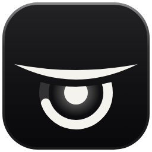
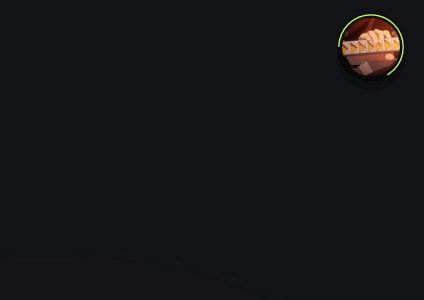
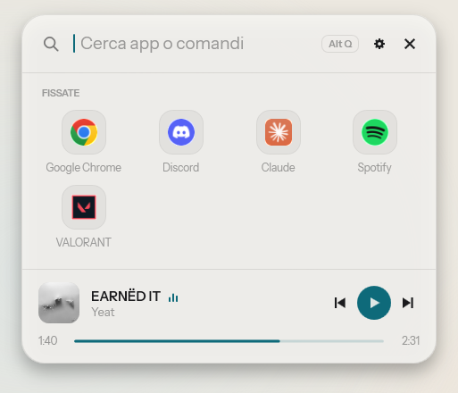
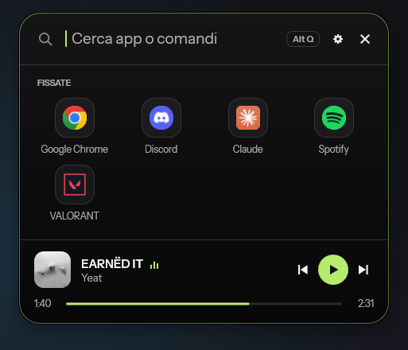
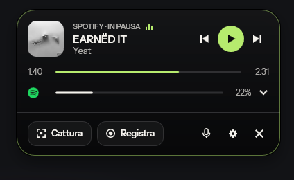
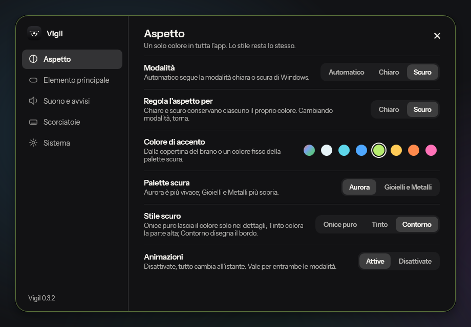

  <a href="README.md">Português</a> · <a href="README.en.md">English</a> · <a href="README.es.md">Español</a> · <b>Italiano</b> · <a href="README.uk.md">Українська</a>

  

<h1 align="center">Vigil</h1>

  <b>Le tue app, la tua musica e i controlli del PC sopra qualsiasi gioco, senza ridurre a icona niente.</b>

  <a href="https://github.com/daniielquintanilha-web/vigil/releases/latest/download/Vigil-Setup.exe"><b>⬇ Scarica per Windows</b></a>
  &nbsp;·&nbsp; Windows 10 e 11

  

## Cos'è

Vigil è una piccola app che resta in un angolo dello schermo. Premi una scorciatoia e compare sopra qualunque cosa sia aperta, anche un gioco a schermo intero, **senza togliergli il focus**. Il gioco non si riduce a icona e non serve Alt+Tab.

## Il Sentinel: la tua GIF nell'angolo

  

- **Metti la GIF che vuoi:** un personaggio, il tuo animale, un meme. Vanno bene anche video brevi (MP4) e WebP: basta trascinarli da una cartella, o direttamente dal browser, sopra il Sentinel.
- **Nella forma che preferisci:** cerchio, pillola, rettangolo o quadrato, e regoli inquadratura e zoom.
- **Mascotte:** la GIF libera e più grande, senza cornice, con il brano in un fumetto accanto.
- **La tua collezione:** le GIF restano salvate e le cambi con il tasto destro. Nei giochi a schermo intero può fermarsi per non pesare.
- **Passaci sopra con il mouse** e il cerchio si apre in una capsula, con il nome del brano.
- **Clicca o premi Alt+W** e diventa lui stesso il pannello: musica, volume, microfono, cattura.
- **Il contorno è il tempo del brano:** il bordo si riempie mentre suona.
- Lo preferisci in alto? Sostituisci il Sentinel con l'**Isola**.

## Cosa fa

- **Alt+Q, il launcher:** cerca e apri qualsiasi app, fissa le preferite e usa comandi rapidi (`yt`, `g`, `w`… per cercare su YouTube, Google, Wikipedia).
- **Alt+W, il pannello:** tempo del brano, volume del PC e di ogni app, microfono, screenshot e registrazione dello schermo.
- **Alt+M, il microfono:** disattiva e riattiva, con un avviso sullo schermo (anche dentro il gioco).
- **Va d'accordo con Discord:** con il launcher aperto, il "premi per parlare" continua a funzionare.
- **Avvisi sopra il gioco:** quando cambiano il volume o il microfono compare un breve avviso, dove Windows non mostra nulla.
- **Funziona con** Spotify, YouTube Music, il browser e qualsiasi player che compare nei controlli multimediali di Windows.
- **Si fa da parte nei video:** durante un film o una serie a schermo intero, sparisce da solo.
- **Come vuoi tu:** modalità chiara o scura, trasparenza, colore di accento (qualsiasi colore della ruota o preso dalla copertina), tre dimensioni, l'Isola in alto come alternativa e scorciatoie modificabili, anche con un solo tasto (come F2).
- **5 lingue:** português, English, español, italiano, українська.
- **Si aggiorna da solo.**

## Immagini

| Chiaro | Scuro (verde) |
|:---:|:---:|
|  |  |

| Pannello (Alt+W) | Impostazioni |
|:---:|:---:|
|  |  |

## Installare

1. Scarica **[Vigil-Setup.exe](https://github.com/daniielquintanilha-web/vigil/releases/latest/download/Vigil-Setup.exe)**.
2. Aprilo. Si installa in pochi secondi, senza chiedere permessi di amministratore, e si apre da solo.
3. Premi **Alt+Q**.

### Compare "Windows ha protetto il PC"?

Windows mostra questo avviso per i programmi nuovi che non hanno ancora una firma digitale a pagamento (un certificato). **Non vuol dire che ci sia un virus**: vuol dire che Windows non conosce ancora il programma. Per continuare, clicca su **Ulteriori informazioni** e poi su **Esegui comunque**.

## È sicuro?

- **Non raccoglie nulla.** Niente account, niente login, niente pubblicità, nessun tracciamento.
- **Usa internet solo per cercare aggiornamenti**, qui in questo repository, e per scaricare l'immagine che trascini dal browser sul Sentinel. Le ricerche (YouTube, Google…) aprono il browser solo quando lo chiedi tu.
- **La tastiera viene letta solo mentre il launcher è aperto**, per scrivere la ricerca. Lo chiudi e basta.
- **Il microfono non viene registrato né ascoltato.** Il pulsante attiva e disattiva soltanto il microfono di Windows.
- **Non tocca il gioco.** È solo una finestra sopra; non modifica i file né la memoria di nessun gioco.
- **Non chiede l'amministratore** e si installa solo nella tua cartella utente.
- **Disinstallare:** Impostazioni di Windows › App › Vigil › Disinstalla.
- **Scaricalo sempre da qui** (github.com/daniielquintanilha-web/vigil).

## Requisiti

Windows 10 (versione 2004 o successiva) o Windows 11, 64 bit.

## Diritti

© 2026 Daniel Quintanilha. Tutti i diritti riservati.

Puoi scaricare e usare Vigil liberamente. Non è consentito copiare, modificare, decompilare, rivendere o ridistribuire l'app (o parti di essa) senza l'autorizzazione dell'autore.
