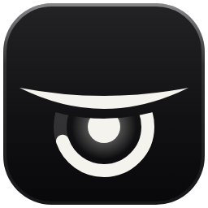
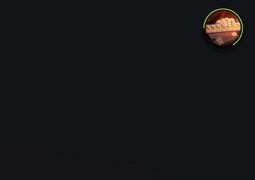
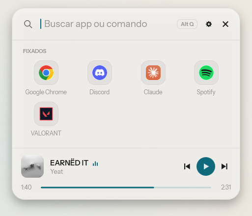
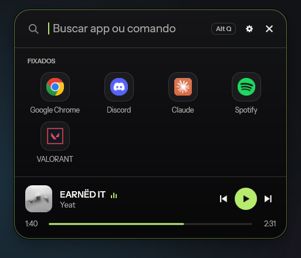
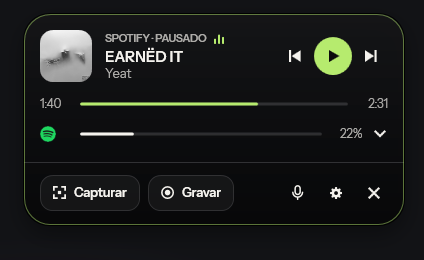
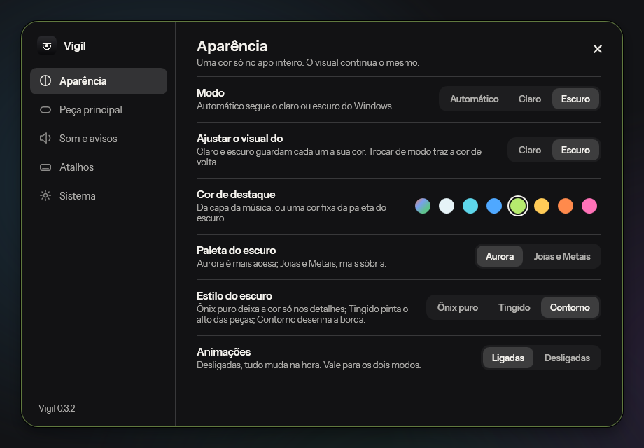

  <b>Português</b> · <a href="README.en.md">English</a> · <a href="README.es.md">Español</a> · <a href="README.it.md">Italiano</a> · <a href="README.uk.md">Українська</a>

  

<h1 align="center">Vigil</h1>

  <b>Seus apps, sua música e os controles do PC por cima de qualquer jogo, sem minimizar nada.</b>

  <a href="https://github.com/daniielquintanilha-web/vigil/releases/latest/download/Vigil-Setup.exe"><b>⬇ Baixar para Windows</b></a>
  &nbsp;·&nbsp; Windows 10 e 11

  

## O que é

O Vigil é um app pequeno que fica no canto da tela. Você aperta um atalho e ele aparece por cima do que estiver aberto, inclusive de um jogo em tela cheia, **sem tirar o foco dele**. O jogo não minimiza e você não precisa dar Alt+Tab.

## O Sentinel: seu GIF no canto da tela

  

- **Coloque o GIF que quiser:** um personagem, seu pet, um meme. Vale também vídeo curto (MP4) e WebP: é só arrastar da pasta, ou direto do navegador, para cima do Sentinel.
- **No formato que combinar:** círculo, pílula, retângulo ou quadrado, e você ajusta o enquadramento e o zoom.
- **Mascote:** o GIF solto e maior, sem moldura, com a música num balão ao lado.
- **Sua coleção:** os GIFs ficam guardados e você troca com o botão direito. Em jogo de tela cheia, ele pode parar para não pesar.
- **Passe o mouse** e o círculo se abre em cápsula, com o nome da música.
- **Clique ou aperte Alt+W** e ele mesmo vira o painel: música, volume, microfone, captura.
- **O contorno é o tempo da música:** a borda vai se preenchendo enquanto ela toca.
- Prefere no topo da tela? Troque o Sentinel pela **Ilha**.

## O que ele faz

- **Alt+Q, o launcher:** busque e abra qualquer app, fixe os favoritos e use comandos rápidos (`yt`, `g`, `w`… para pesquisar no YouTube, no Google, na Wikipédia).
- **Alt+W, o painel:** tempo da música, volume do PC e de cada app, microfone, captura e gravação de tela.
- **Alt+M, o microfone:** muta e desmuta, com um aviso na tela (até dentro do jogo).
- **Combina com o Discord:** com o launcher aberto, o "apertar para falar" continua funcionando.
- **Avisos por cima do jogo:** quando o volume ou o microfone mudam, aparece um aviso rápido, onde o Windows não mostra nada.
- **Funciona com** Spotify, YouTube Music, o navegador e qualquer player que apareça nos controles de mídia do Windows.
- **Sai da frente nos vídeos:** num filme ou série em tela cheia, ele some sozinho.
- **Do seu jeito:** modo claro ou escuro, transparência, cor de destaque (qualquer cor da roda ou tirada da capa da música), três tamanhos, a Ilha no topo da tela como alternativa e atalhos que você pode trocar, até por uma tecla só (como F2).
- **5 idiomas:** português, English, español, italiano, українська.
- **Atualiza sozinho.**

## Imagens

| Claro | Escuro (verde) |
|:---:|:---:|
|  |  |

| Painel (Alt+W) | Ajustes |
|:---:|:---:|
|  |  |

## Instalar

1. Baixe o **[Vigil-Setup.exe](https://github.com/daniielquintanilha-web/vigil/releases/latest/download/Vigil-Setup.exe)**.
2. Abra. Ele instala em segundos, sem pedir permissão de administrador, e já abre sozinho.
3. Aperte **Alt+Q**.

### Apareceu "O Windows protegeu o computador"?

O Windows mostra esse aviso para programas novos que ainda não têm uma assinatura digital paga (um certificado). **Não quer dizer que tem vírus**: quer dizer que o Windows ainda não conhece o programa. Para continuar, clique em **Mais informações** e depois em **Executar assim mesmo**.

## É seguro?

- **Não coleta nada.** Sem conta, sem login, sem anúncios, sem rastreamento.
- **Só usa a internet para procurar atualizações**, aqui neste repositório, e para baixar a imagem que você arrasta do navegador para o Sentinel. As buscas (YouTube, Google…) só abrem o seu navegador quando você pede.
- **O teclado só é lido enquanto o launcher está aberto**, para você digitar a busca. Fechou, parou.
- **O microfone não é gravado nem escutado.** O botão só liga e desliga o microfone do Windows.
- **Não mexe no jogo.** É só uma janela por cima; não altera arquivos nem a memória de nenhum jogo.
- **Não pede administrador** e instala só na sua pasta de usuário.
- **Desinstalar:** Configurações do Windows › Aplicativos › Vigil › Desinstalar.
- **Baixe sempre por aqui** (github.com/daniielquintanilha-web/vigil).

## Requisitos

Windows 10 (versão 2004 ou mais nova) ou Windows 11, 64 bits.

## Direitos

© 2026 Daniel Quintanilha. Todos os direitos reservados.

Você pode baixar e usar o Vigil à vontade. Não é permitido copiar, modificar, descompilar, revender ou redistribuir o app (ou partes dele) sem autorização do autor.
