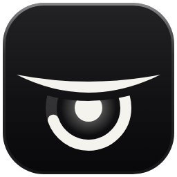
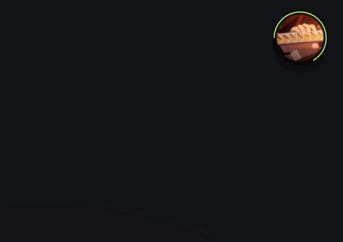
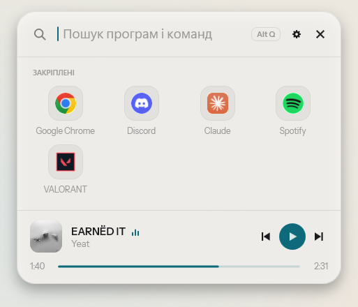
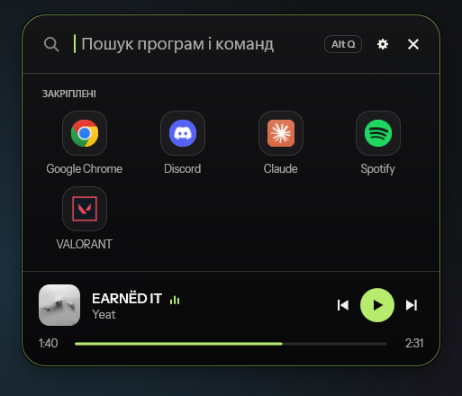
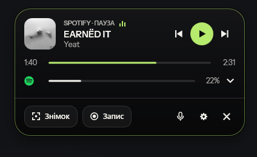
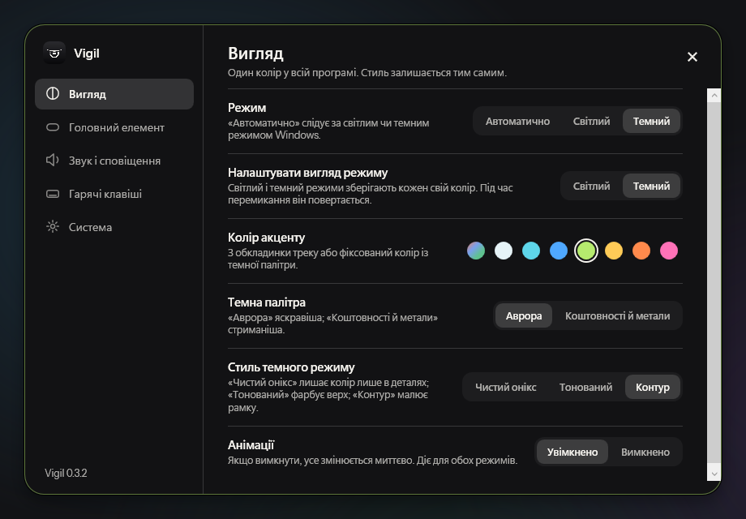

  <a href="README.md">Português</a> · <a href="README.en.md">English</a> · <a href="README.es.md">Español</a> · <a href="README.it.md">Italiano</a> · <b>Українська</b>

  

<h1 align="center">Vigil</h1>

  <b>Ваші програми, музика й керування ПК поверх будь-якої гри, нічого не згортаючи.</b>

  <a href="https://github.com/daniielquintanilha-web/vigil/releases/latest/download/Vigil-Setup.exe"><b>⬇ Завантажити для Windows</b></a>
  &nbsp;·&nbsp; Windows 10 і 11

  

## Що це

Vigil — невелика програма, що живе в кутку екрана. Натискаєте гарячу клавішу, і вона з'являється поверх усього відкритого, навіть гри на весь екран, **не забираючи в неї фокус**. Гра не згортається, і Alt+Tab не потрібен.

## Sentinel: ваш GIF у кутку екрана

  

- **Поставте будь-який GIF:** персонажа, свого улюбленця, мем. Він живе в кутку, у колі або в капсулі з музикою, що грає.
- **Наведіть курсор**, і коло розкривається в капсулу з назвою треку.
- **Клацніть або натисніть Alt+W**, і він сам перетворюється на панель: музика, гучність, мікрофон, знімок екрана.
- **Контур показує час треку:** рамка заповнюється, поки трек грає.
- Хочете вгорі екрана? Замініть Sentinel на **«Острів»**.

## Що вона вміє

- **Alt+Q, лаунчер:** шукайте й відкривайте будь-яку програму, закріплюйте улюблені й користуйтеся швидкими командами (`yt`, `g`, `w`… для пошуку в YouTube, Google, Вікіпедії).
- **Alt+W, панель:** час треку, гучність ПК і кожної програми, мікрофон, знімок і запис екрана.
- **Alt+M, мікрофон:** вимикає й вмикає, зі сповіщенням на екрані (навіть у грі).
- **Сповіщення поверх гри:** коли змінюється гучність чи мікрофон, з'являється коротке сповіщення там, де Windows нічого не показує.
- **Працює з** Spotify, YouTube Music, браузером і будь-яким плеєром, що є в елементах керування мультимедіа Windows.
- **Не заважає дивитися відео:** під час фільму чи серіалу на весь екран вона сама ховається.
- **Як вам зручно:** світлий або темний режим, акцентний колір (сталий або з обкладинки), три розміри, «Острів» угорі екрана як альтернатива і гарячі клавіші, які можна змінити.
- **5 мов:** português, English, español, italiano, українська.
- **Оновлюється сама.**

## Зображення

| Світлий | Темний (зелений) |
|:---:|:---:|
|  |  |

| Панель (Alt+W) | Налаштування |
|:---:|:---:|
|  |  |

## Встановлення

1. Завантажте **[Vigil-Setup.exe](https://github.com/daniielquintanilha-web/vigil/releases/latest/download/Vigil-Setup.exe)**.
2. Відкрийте його. Встановлення триває кілька секунд, без прав адміністратора, і програма одразу запускається.
3. Натисніть **Alt+Q**.

### З'явилося «Windows захистила ваш ПК»?

Windows показує це попередження для нових програм, які ще не мають платного цифрового підпису (сертифіката). **Це не означає, що там вірус**: це означає, що Windows ще не знає цієї програми. Щоб продовжити, натисніть **Докладніше**, а потім **Однаково запустити**.

## Чи це безпечно?

- **Нічого не збирає.** Без облікового запису, без входу, без реклами, без стеження.
- **Інтернет потрібен лише для перевірки оновлень** у цьому репозиторії. Пошук (YouTube, Google…) відкриває браузер тільки тоді, коли ви просите.
- **Клавіатура зчитується лише тоді, коли відкрито лаунчер**, щоб ви могли ввести запит. Закрили, і все.
- **Мікрофон не записується і не прослуховується.** Кнопка лише вмикає й вимикає мікрофон Windows.
- **Не втручається в гру.** Це просто вікно поверх неї; воно не змінює файли чи пам'ять жодної гри.
- **Не потребує прав адміністратора** і встановлюється лише у вашу папку користувача.
- **Видалення:** Параметри Windows › Програми › Vigil › Видалити.
- **Завантажуйте лише звідси** (github.com/daniielquintanilha-web/vigil).

## Вимоги

Windows 10 (версія 2004 або новіша) чи Windows 11, 64-біт.
